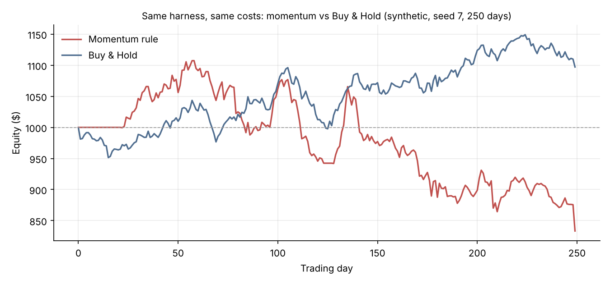

# toss-llm-trader

> LLM에게 주식 매매 전권을 주면, **그냥 사서 들고 있는 것(Buy&Hold)보다 나을까?** 이걸 재현 가능하게 측정하는 실험

미국 주식, $1000 상한, 페이퍼(모의) 매매 우선. 목표는 "돈 버는 봇"이 아니라 **공정한 측정 환경**을 만드는 것입니다.

```
관찰(point-in-time) → 전략(모멘텀 규칙 | LLM 에이전트) → 얇은 안전판 → 모의 체결(수수료·슬리피지·소수점) → 원장 → 성과 지표 (vs Buy&Hold)
```

<br>

## 📌 문제 정의 / 만든 이유

"LLM 트레이딩 봇으로 수익 냈다"는 글은 많지만, 대부분 비교 기준이 없거나 백테스트가 미래 데이터를 몰래 보고 있습니다. 그래서 질문을 바꿨습니다.

- LLM 전략을 **규칙 기반 전략, Buy&Hold와 똑같은 환경**에 넣으면 어떤 결과가 나오나?
- 백테스트가 **그날 시점에 알 수 있었던 정보만** 쓰게 하려면 어떻게 해야 하나?
- 실제 계좌에 연결해도 **기존 보유 주식은 절대 건드리지 않게** 하려면?

<br>

## 📊 지금까지의 결과

비교 기준이 제대로 동작하는지부터 확인했습니다. 합성 데이터 250거래일, seed 7로 모멘텀 규칙 전략을 돌린 결과입니다.

| 지표 | 모멘텀 규칙 | Buy&Hold |
| --- | ---: | ---: |
| 누적 수익률 | -16.67% | +9.77% |
| 샤프 | -0.95 | 0.90 |
| MDD | -24.75% | -8.97% |
| 최종 자산 | $833 | $1,097 |



규칙 전략이 Buy&Hold를 못 이기는 건 정상입니다. 대부분의 전략이 그렇고, 이 하네스가 전략을 봐주지 않는다는 뜻이기도 합니다. LLM 전략은 같은 환경에서 Forward 페이퍼 테스트로 거래일마다 누적 측정하는 중입니다.

> 재현: `python3 -m src.main --days 250 --seed 7` (외부 의존성 없음)

<br>

## 🛠 기술 스택 + 선정 이유

| 기술 | 이유 |
| --- | --- |
| Python 표준 라이브러리 중심 | 규칙 전략과 테스트는 의존성 없이 돌아가야 누구나 재현할 수 있다 |
| Claude (tool-calling) | `submit_decision` 도구 호출을 강제해 종목별 목표 비중을 구조화된 형태로만 받는다. 자유 텍스트 파싱이 없다 |
| 프롬프트 캐싱 | 매 거래일 같은 시스템 프롬프트를 반복하므로 캐싱으로 호출 비용을 줄였다 |
| yfinance / 합성 데이터 | 실데이터와 재현용 합성 데이터를 같은 인터페이스로 바꿔 끼운다 |
| 토스증권 Open API | 단계 4 실거래용 브로커. 기본은 dry-run |

<br>

## 🔧 설계 결정 기록

**미래 데이터 누수 막기**
- **문제:** 백테스트에서 전략이 그날 종가 이후 데이터를 조금이라도 보면 성과가 부풀려진다. LLM은 특히 이런 누수를 알아채기 어렵다.
- **결정:** 실무 퀀트의 point-in-time DB 개념을 시계 하나로 단순화했다(`core/clock.py`). 가격 저장소는 항상 "현재 시각 기준 as-of 조회"만 허용한다.

**판단은 LLM, 안전판은 얇게**
- **고민:** 안전 규칙을 많이 넣으면 그건 LLM 실험이 아니라 규칙 실험이 된다.
- **결정:** 리스크 모듈은 잔고, 주문 유효성, $1000 한도만 검사한다. 종목·방향·비중·타이밍은 전부 LLM이 정한다. 대신 장중 서킷브레이커(당일 시작 자산 대비 임계 도달 시 전량 청산)는 결정론 코드로 따로 둔다.

**기존 보유 주식 보호 (카브아웃 회계)**
- **문제:** 증권 계좌 안에서는 기존 보유분과 실험 보유분이 물리적으로 나뉘지 않는다. 리밸런싱하면 원래 가지고 있던 주식까지 팔 수 있다.
- **결정:** 실험 시작 시점의 보유 수량을 보호 기준선으로 저장하고, 실험이 산 수량만 따로 장부에 기록한다(`ExperimentPortfolio`, `CarveOutBroker`). 장부와 실제 계좌가 어긋나면 신규 주문을 멈춘다.

<br>

## ✅ 테스트

테스트 파일 18개, 테스트 함수 162개. 네트워크와 LLM 없이 상태 영속성, 거래일 연속성, 서킷브레이커, 카브아웃 회계를 검증합니다.

<br>

## 🚀 실행 방법
```bash
# 규칙 전략(모멘텀) — 외부 의존성 0, 표준 라이브러리만
python3 -m src.main --days 250 --seed 7
python3 -m src.main --symbols AAPL,MSFT,NVDA --source yfinance   # 실데이터(pip install yfinance)

# LLM 에이전트 — .env에 ANTHROPIC_API_KEY 필요(자동 로드)
python3 -m src.main --strategy llm --days 20                                          # 합성데이터
python3 -m src.main --strategy llm --source yfinance --symbols AAPL,MSFT,NVDA --days 20

python3 tests/test_smoke.py && python3 tests/test_llm_agent.py   # 테스트
```
> `--days N`: 마지막 N 거래일만 매매·측정(그 이전은 워밍업 history). LLM은 opus-5 콜당 ~$0.018.

### Forward 페이퍼 테스트
백테스트와 달리 **거래일마다 1회 실행**하고 상태(포지션·현금·회고·B&H 앵커)를 `logs/forward/`에
영속화해 다음 날 이어받는다. 실시간 모의로 Buy&Hold 대비 성과를 누적 측정.
```bash
# 하루치 실행(오늘 종가로 결정·모의체결·상태 갱신). cron/작업 스케줄러로 매 거래일 1회.
python3 -m src.forward_main --symbols AAPL,MSFT,NVDA --strategy llm
python3 -m src.forward_main --symbols AAPL,MSFT,NVDA --strategy momentum --source yfinance

python3 -m src.forward_main --report   # 지금까지 누적 총평(전략 vs B&H 위험조정 지표)
python3 tests/test_forward.py          # 테스트(네트워크·LLM 없이 영속성·연속성 검증)
```
> 같은 거래일 재실행은 자동 skip(`--force`로 강제). 상태 파일이 곧 페이퍼 계좌(로컬 시뮬레이션 —
> `TossBroker` 라우팅은 단계 4용). 자동화: Windows는 작업 스케줄러, Linux/mac은 cron으로 평일 장마감 후 1회.

## 📁 코드 구조
| 폴더 | 역할 |
|---|---|
| `core/` | 데이터 계약(Signal/Order/...) + point-in-time 시계(누수 방지) |
| `data/` | 가격 저장소(as-of 조회) + 합성/yfinance 로더 |
| `strategy/` | 전략 인터페이스 + 모멘텀 베이스라인 + **`llm_agent/`** (Claude 에이전트·메모리·회고·캐싱) |
| `risk/` | 얇은 안전판(잔고·유효성·$1000 한도만, 판단은 LLM 전권) |
| `execution/` | 브로커 추상 + 모의 브로커 + 리밸런서 + **`toss_broker.py`**(토스 REST 실거래) |
| `forward/` | **Forward 페이퍼 하네스** — 상태 영속화(`state.py`) + 하루 1회 러너(`runner.py`) |
| `experiment/` | 원장(JSONL) · 성과지표 · Buy&Hold 대조군 |

## 🗺 진행 단계
1. ✅ **LLM 에이전트 전략** (`strategy/llm_agent/`) — tool-calling 결정 · 메모리·회고 · 캐싱
2. ✅ **TossBroker** (`execution/toss_broker.py`) — 토스 Open API REST 연동(OAuth2·시세·잔고·주문). 실스펙 정합·단위테스트·**실키 읽기연동 검증 완료**. 기본 dry-run(실주문은 `TRADING_MODE=live`).
   - 실키 연결 검증(읽기 전용, 주문 미전송): `cp .env.example .env`로 앱키/시크릿 채운 뒤 `python3 scripts/verify_toss_connection.py` (계좌번호는 자동 탐색; IP allowlist 등록 필요)
   - ⚠️ **실계좌 주의**: `live`는 연결된 계좌를 전략 목표비중으로 리밸런싱한다. 기존 보유분이 있는 실제 계좌에 걸면 청산될 수 있으므로, 실거래는 **전용 계좌**에서만.
3. ✅ **Forward 페이퍼 테스트 + 카브아웃 회계** (`forward/`) — 하루 1회 실행·상태 영속화·중복방지·B&H 앵커 고정. `ExperimentPortfolio`·`CarveOutBroker`로 기존 보유분을 건드리지 않고 실험분만 격리 추적(next-bar 집행·NAV 복리 재투자).
4. ✅ **실시간 일중 서킷브레이커** (`market/`·`risk/day_risk.py`·`runtime/`) — 장중 상시 감시로 당일 시작자산 대비 +임계/-임계 도달 시 전량 강제청산. 개장 1회 LLM 결정 + 결정론적 서킷브레이커. 크래시·재시작 내성(`IntradayState`).
5. ✅ **메타-포트폴리오(전략 배분)** (`portfolio/`·`runtime/meta_orchestrator.py`) — 여러 전략을 자본·리스크 예산으로 배분(Fixed·역변동성·리스크패리티) + 슬리브별 독립 서킷브레이커. 설계: `docs/design-meta-portfolio.md`·`docs/design-sleeve-accounts.md`.
6. (선택) 실계좌 $1000 — 페이퍼·dry-run 검증 통과 후
