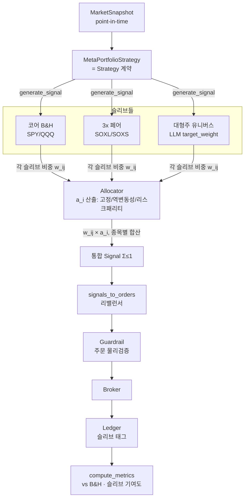

# 메타-포트폴리오(전략 배분 레이어) 설계

> 여러 전략을 **자본·리스크 예산으로 배분**해 한 계좌로 굴리고, 단일 전략/단일 Buy&Hold 대비
> **위험조정수익이 개선되는지** 측정한다. 설계 근거·측정 계획·단계 로드맵.

---

## 0. 한 문장 요구사항
전략 N개(코어 B&H · 3x 인버스 페어 · 대형주 유니버스 …)를 **슬리브(sleeve: 한 전략에 배정된 자본 몫)** 로 꽂고,
**배분 정책**이 각 슬리브의 자본 비중 `a_i`를 정해 하나의 포트폴리오로 합성한다. 기존 측정 틀(`main.py`, vs B&H)을
그대로 재사용해 "메타-포트폴리오가 단일 전략보다 나은가"를 재현 가능하게 잰다.

## 1. 왜 지금 이걸 하나 (맥락)
지금까지는 **단일 전략 = 단일 비중벡터 = 단일 계좌**였다. 3x 페어는 위성(satellite) 성격(고변동·고알파),
코어(SPY/QQQ B&H)는 안정, 유니버스는 분산 — 셋의 **상관이 낮으면 결합 시 MDD↓·Sharpe↑**(분산효과)가
기대된다. 이 가설을 **측정**하는 것이 이 레이어의 존재 이유다(수익 봇이 아니라 실험).

---

## 2. 핵심 설계 결정 (Trade-off·면접 설명 포함)

### 결정 1 — 메타-포트폴리오는 그 자체가 `Strategy`다 (Composite 패턴)
**Composite 패턴 (컴포지트: 부분과 전체를 같은 인터페이스로 다뤄 재귀 합성)** 으로,
`MetaPortfolioStrategy(Strategy)` 가 서브전략들의 `generate_signal`을 호출→비중을 `a_i`로 스케일→
종목별 합산→통합 `Signal` 리스트를 반환한다.

- **선택 이유**: 기존 `Strategy` 계약(`snapshot→signals`, Σw≤1)만 지키면 **측정 평면(main.py)·실행 평면
  (orchestrator)** 양쪽에 **무수정**으로 꽂힌다. 드라이버는 그게 단일 전략인지 합성인지 몰라도 된다.
- **수학적 안전**: 각 슬리브 `Σ_j w_ij ≤ 1`, 배분 `Σ_i a_i ≤ 1` 이면 합성
  `Σ_i a_i·(Σ_j w_ij) ≤ Σ_i a_i ≤ 1` — **예산 초과 노출이 원천 불가**(리밸런서 정규화와 이중 안전).
- **대안**: 별도 오케스트레이션 레이어 신설 → 두 러너를 다 고쳐야 하고 계약이 갈라진다.
- **Trade-off**: 재사용·단순함 최고 ↔ v1에서는 슬리브들이 **한 브로커·한 서킷을 공유**(슬리브별 독립
  리스크 불가). → 결정 3에서 단계적으로 해소.
- **면접 설명법**: "전략을 Composite로 재귀 합성했습니다. 메타-포트폴리오가 `Strategy`를 구현하니 개별
  전략과 완전 대칭이라, 백테스트 드라이버는 리스코프 치환 원칙(LSP)상 둘을 구분할 필요가 없습니다.
  덕분에 배분 로직을 추가하면서 측정 코드는 한 줄도 안 바뀌었습니다."

### 결정 2 — 배분 정책은 전략과 분리된 `Allocator`로 (직교 분리)
`Allocator.weights(sleeves, history) -> {name: a_i}`. 정책 구현체:
`FixedAllocator`(고정) · `InverseVolAllocator`(역변동성) · `RiskParityAllocator`(리스크패리티) ·
`PerfMomentumAllocator`(최근 성과 가중).

- **용어**: **역변동성 (inverse-vol): 변동성이 큰 슬리브에 자본을 적게** — `a_i ∝ 1/σ_i`.
  **리스크패리티 (risk-parity): 각 슬리브의 기여 리스크를 균등**하게(변동성뿐 아니라 상관까지 반영).
- **선택 이유**: "무엇을 배분하나(정책)"와 "어떻게 신호를 합치나(합성)"는 **다른 축** → 단일책임(SRP).
  정책만 갈아끼워 **A/B 측정**하는 게 이 프로젝트의 핵심 질문이라 추상 하나 값어치를 한다.
- **Trade-off**: 클래스 하나 증가 ↔ 정책 실험이 곧 실험 목적이라 이득이 비용을 넘음.
- **면접 설명법**: "전략(무엇을 살까)과 배분(각 전략에 얼마를 줄까)을 직교 분리해, 배분 정책을
  데이터로 비교하는 실험 설계로 만들었습니다. 고정 → 역변동성 → 리스크패리티로 정책만 교체하며
  Sharpe·MDD 변화를 측정합니다."

### 결정 3 — v1은 단일계좌 비중혼합, v2는 슬리브=서브계좌 (단계 분리)
- **v1 (Composite blend)**: 한 브로커, 비중 합산. 즉시 `main.py`에서 vs B&H 측정 가능.
- **v2 (Sleeve sub-accounts)**: 슬리브별 자본 슬라이스 + **독립 `DayRiskManager`**(장중 서킷). `main` 브랜치의
  `CarveOutBroker`/`ExperimentPortfolio`(카브아웃 회계) 개념을 재사용 → 슬리브별 서킷·정확한 기여도.
- **선택 이유**: 가치를 **빨리 재고**(v1), 복잡한 회계·독립 리스크는 근거가 생긴 뒤(v2). 브랜치 통합
  방향(카브아웃 base + 서킷 이식)과도 정합.
- **Trade-off (명시적 한계)**: v1은 슬리브 독립 리스크가 없다 — **3x 페어 슬리브의 −2% 서킷이 코어 B&H까지
  같이 끌고 내려간다**(전체 NAV 앵커 공유). 이걸 알고 쓰되, 독립 서킷이 실험에 유의미해지면 v2로 승격.
- **면접 설명법**: "MVP는 비중 혼합 단일계좌로 빠르게 측정하고, 슬리브별 독립 서킷이 필요하다는 근거가
  데이터로 나오면 서브계좌(카브아웃)로 승격하는 단계 설계입니다. 한계를 문서에 명시해 은닉 리스크로
  두지 않았습니다."

### 결정 4 — 측정은 위험조정수익 우선 (기존 지표 재사용)
`compute_metrics`(Sharpe·Sortino·MDD·Calmar) + **슬리브 기여도(attribution)** + 3중 비교군.
- **선택 이유**: 메타-포트폴리오의 존재 이유가 "분산으로 **위험조정** 수익 개선"이므로, 총수익률만이 아니라
  Sharpe/MDD가 1차 지표. 페어 하네스에서 세운 "기대값·손익비·Sharpe 함께" 원칙과 일관.

---

## 3. 아키텍처 / 데이터 흐름



**두 평면과의 관계**
- **측정 평면(`main.py`)**: 일별 리밸런스로 vs B&H를 잰다 — 메타-포트폴리오의 **본진**.
- **실행/리스크 평면(`orchestrator.py`)**: 장중 서킷브레이커. v1은 전체 NAV에 하나, v2는 슬리브별.
- 메타-포트폴리오는 `Strategy`이므로 두 평면 어디든 동일하게 꽂힌다(결정 1).

---

## 4. 파일 구조

```
src/portfolio/                      # 신규 패키지 — 배분 레이어
  __init__.py
  sleeve.py         # Sleeve: name·strategy·symbols·(v2)risk. 슬리브 1개의 정의.
  allocator.py      # Allocator ABC + Fixed/InverseVol/RiskParity/PerfMomentum
  meta.py           # MetaPortfolioStrategy(Strategy) — Composite 합성기
tests/test_meta_portfolio.py        # 순수 로직 단위테스트(네트워크 0)
docs/design-meta-portfolio.md       # 이 문서

# 배선(기존 파일 소폭 수정)
src/main.py         # --strategy meta 분기 + 슬리브/배분 CLI
src/experiment/ledger.py            # (선택) 슬리브 태그 필드

# v2(후속)
src/execution/sleeve_broker.py      # 또는 main 브랜치 CarveOutBroker 이식
```

## 5. 각 파일 역할

- **`sleeve.py`** — `Sleeve(name, strategy, symbols)` 데이터클래스. 한 슬리브 = "이 전략에 이 유니버스".
  v2에서 `risk: DayRiskManager | None`, `capital: float` 추가.
- **`allocator.py`** — `Allocator.weights(sleeves, history) -> {name: a_i}` (Σa_i ≤ 1). 순수 함수 계열.
  - `FixedAllocator({name: a})`: 고정 비중(예 코어 0.5·페어 0.2·유니버스 0.3).
  - `InverseVolAllocator(lookback)`: 최근 수익률 표준편차로 `a_i ∝ 1/σ_i` 후 정규화.
  - `RiskParityAllocator(lookback)`: 공분산 기반 등리스크(초기엔 역변동성 근사로 시작).
  - `PerfMomentumAllocator(lookback)`: 최근 성과 좋은 슬리브 가중(과최적화 주의 — 후순위).
- **`meta.py`** — `MetaPortfolioStrategy(sleeves, allocator)`:
  1. 각 `sleeve.strategy.generate_signal(snapshot)` 호출 → 슬리브별 `{sym: w}`.
  2. `allocator.weights(...)`로 `a_i` 산출.
  3. `merged[sym] += a_i · w_ij` 합산 → `Signal` 리스트(Σ≤1 보장, 리밸런서가 재정규화도 함).
  4. `name = "meta"`, 슬리브 기여도용 메타데이터를 `last_decision`에 노출(페어 어댑터처럼).
- **`main.py` 배선** — `build_strategy`에 `meta` 분기: 슬리브 구성(코어=Momentum/B&H, 페어=PairDecider,
  유니버스=LLMAgent) + `--allocator {fixed,invvol,...}` 선택.

## 6. 측정 계획 (실험 설계)

- **데이터**: 코어(SPY, QQQ) + 위성(SOXL/SOXS 페어) + 유니버스(대형주 8~12). 일봉, 6~12개월 창.
- **비교군 4종**:
  1. 단일 B&H(SPY) — 절대 기준선.
  2. 각 슬리브 **단독** — 결합의 부가가치 분리.
  3. 메타(**고정** 배분).
  4. 메타(**역변동성** 배분).
- **1차 지표**: Sharpe · Sortino · MDD · Calmar. **보조**: 총수익 · 슬리브 기여도 · 상관행렬.
- **가설**: 상관 낮은 슬리브 결합 시 (3)·(4)가 (1)·(2) 대비 **MDD↓·Sharpe↑**. 역변동성이 고변동 페어의
  낙폭 기여를 눌러 (4) ≥ (3) 예상 — **측정으로 판별**.
- **주의**: 페어/유니버스 슬리브에 LLM이 끼면 비용 발생. 측정 1차는 **결정론 슬리브(B&H·모멘텀·페어 딥게이트)**
  로 배분 로직만 검증 후, LLM 슬리브는 별도로.

## 7. 단계 로드맵

- **v1** — `Sleeve` + `FixedAllocator` + `MetaPortfolioStrategy` → `main.py --strategy meta` 배선 → 비교군 측정.
- **v1.5** — `InverseVolAllocator`·`RiskParityAllocator` 추가 → 배분 정책 A/B.
- **v2** — 슬리브 = 서브계좌(카브아웃) + 슬리브별 독립 `DayRiskManager`(브랜치 통합과 함께). 정확한 기여도.
- **v2.5** — 리밸런싱 주기·비용 실측(잦은 배분 조정 = 수수료) → 최적 주기 탐색.

## 8. 미결정 / 리스크 (구현 전 확정)

- **리밸런싱 주기·비용**: 매일 `a_i` 재산출은 회전율↑·수수료↑. 주간/월간 또는 밴드(임계 이탈 시만) 검토.
- **상관·변동성 추정 창**: look-back 길이·비정상성(regime). 짧으면 노이즈, 길면 지연 — 측정으로 감.
- **v1 공유 서킷 한계**(결정 3): 페어 서킷이 전체를 끌고감. v2 승격 트리거를 데이터로 정의.
- **LLM 슬리브 비용**: 배분이 슬리브 활성 빈도에 영향 → 콜 수·비용 변동. 결정론 슬리브로 먼저 분리 측정.
- **슬리브 상호작용**: 두 슬리브가 같은 종목을 반대로(롱/숏) 잡으면 순노출 상쇄 — 합산 단계에서 순비중으로
  드러나므로 무해하나, 기여도 해석에 주의.

---

## 부록: v1 실측 (2026-08-22, yfinance 120거래일)

**A. equity 라인업**(코어 B&H + 모멘텀, SPY·QQQ·AAPL·MSFT·NVDA) — 동질 슬리브

| 전략 | 누적수익 | Sharpe | Sortino | MDD | Calmar |
|---|---:|---:|---:|---:|---:|
| B&H(동일비중) | 18.3% | 1.95 | 3.29 | −10.5% | 4.04 |
| 모멘텀 단독 | 0.5% | 0.42 | 0.24 | −2.1% | 0.54 |
| meta(fixed 50:50) | 10.5% | **2.16** | **3.82** | **−5.3%** | **4.37** |
| meta(invvol) | 10.5% | 2.17 | 3.82 | −5.3% | 4.38 |

- meta는 **총수익을 내주고 위험조정수익을 샀다**(Sharpe·Calmar↑, MDD 절반). "나쁜 전략(모멘텀)도
  상관이 낮으면 결합 시 낙폭을 방어한다"는 분산의 본질.
- **fixed ≈ invvol**: 두 슬리브가 같은 유니버스라 변동성 추정이 비슷 → 배분 차이 미미. 역변동성의
  진가는 이질 슬리브에서 나온다(아래 B).

**B. core-pair 라인업**(코어 B&H[SPY·QQQ] + 3x 페어 위성[SOXL/SOXS]) — 이질 슬리브

| 배분 | 페어 aᵢ | 누적수익 | Sharpe | MDD | Calmar |
|---|---:|---:|---:|---:|---:|
| fixed(core .7/pair .3) | 0.30 고정 | 11.1% | 1.60 | −6.2% | 3.98 |
| **invvol** | **평균 0.10**(0.045~0.144) | **31.7%** | **3.03** | −6.6% | **11.77** |

- **역변동성이 고변동 페어를 30%→평균 10%로 삭감**(일별 배분 추적). 동질(A)에선 fixed≈invvol이던 게
  이질(B)에선 **크게 갈라짐** → 역변동성의 존재 이유가 실증됨(결정 2).
- 배분 역산: 코어 ≈ **+42%**, 페어 트렌드 슬리브 ≈ **−61%**(3x whipsaw — 방향 전환 SOXL 64/SOXS 38/현금
  18일 + 레버리지 decay). invvol이 이 **드래그 슬리브를 결정론적으로 굶겨** 수익·Sharpe를 끌어올림.
- **"방향이 곧 알파"**(design-leveraged-pair §부록)가 포트폴리오 레벨에서 재확인 — 결정론 추세추종은 3x에서
  붕괴. 방향 판단은 LLM 몫이지 결정론 대리 불가.
- **주의**: 이 B&H 벤치마크(−50.9% MDD)는 SOXL+SOXS **동시보유**로 decay 자멸 → 여기선 허수아비. n=1 창·
  상승 레짐·결정론 페어라 **결론 아닌 방향 신호**.

---
*권장 실행 순서: v1(고정배분 Composite) 구현 → 비교군 4종 측정 → 역변동성 추가 → (근거 시) v2 서브계좌.*
*관련: [[design-leveraged-pair]](페어 슬리브 = 위성), 브랜치 통합(카브아웃 base) = v2 접점.*
